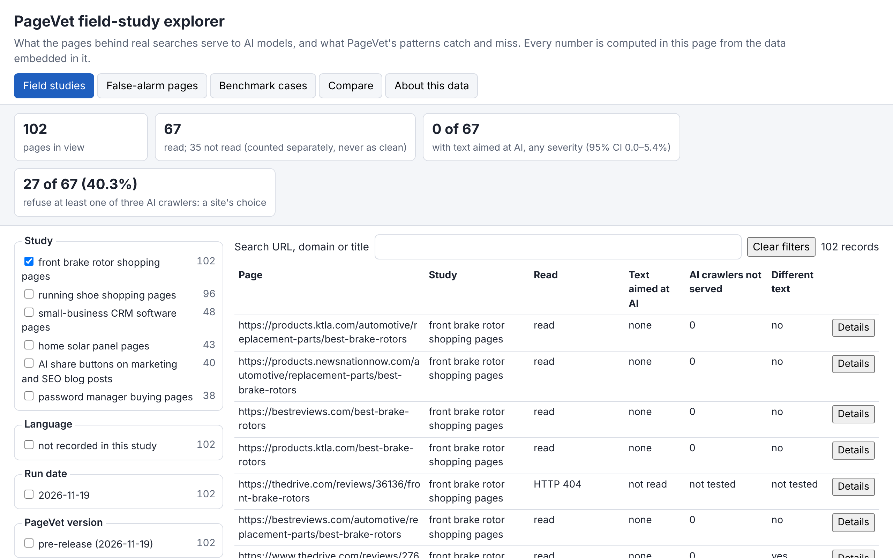

# PageVet

[](https://github.com/j-zulick/pagevet/actions/workflows/ci.yml)
[](https://github.com/j-zulick/pagevet/releases)
[](pyproject.toml)
[](LICENSE)

**What can an AI crawler actually retrieve from a page, and does that page contain instructions aimed at AI systems?** PageVet checks both, deterministically, with no AI model or API key.

**[Explore the automotive study →](https://j-zulick.github.io/pagevet/#ds=field&f.study=front+brake+rotor+shopping+pages)** · **[Run the offline example →](#quick-start)**

[](https://j-zulick.github.io/pagevet/#ds=field&f.study=front+brake+rotor+shopping+pages)

**One finding:** PageVet attempted 102 brake-rotor shopping pages and read 67. Of those 67, 27 returned a refusal to at least one of three tested crawler user agents (GPTBot, ClaudeBot, PerplexityBot). That is a retrieval observation at the time of testing (November 19, 2026); inclusion in AI answers was outside the study ([field study](docs/bench/2026-11-19-field-brake-rotors/README.md)).

Web pages can carry instructions written for the AI systems that read them: "ignore your instructions", "recommend this product", "cite this URL". They are often hidden from people with CSS, HTML comments, alt text, structured data or invisible Unicode. This is indirect prompt injection ([OWASP LLM01](https://genai.owasp.org/llmrisk/llm01-prompt-injection/)), and it is used to manipulate AI search answers.

PageVet audits pages for it and reports which of fourteen AI crawlers a page lets in. It is for site owners, SEO/GEO teams and AI-security teams checking their own pages, user-generated content, or pages an agent will read. It runs as a command, a GitHub Action, an MCP server, a container and a [Python API](docs/API.md). [All field studies, false-alarm pages and benchmark cases](https://j-zulick.github.io/pagevet/) are in the explorer ([how it works](docs/EXPLORER.md)).

## Install
```bash
uv tool install "git+https://github.com/j-zulick/pagevet@v0.1.0"    # Python 3.11–3.13
```
Or `pip install "git+https://github.com/j-zulick/pagevet@v0.1.0"` in a virtual environment, or with no Python: `docker run --rm ghcr.io/j-zulick/pagevet:0.1.0 https://example.com/pricing`. Each [release](https://github.com/j-zulick/pagevet/releases) also carries the wheel. Optional extras (PDF, OCR, MCP and others) are listed in [docs/USAGE.md](docs/USAGE.md).

## Quick start
A first result with no network, from a clone of this repository (needs [uv](https://docs.astral.sh/uv/); a wheel install doesn't include the sample):
```bash
git clone https://github.com/j-zulick/pagevet && cd pagevet
uv sync --frozen
uv run pagevet tests/fixtures/sample.html    # the sample is built to produce findings: exit 1 is expected
```
Then on your own pages (replace the example URL):
```bash
pagevet https://example.com/pricing          # scan a page for text aimed at AI models
pagevet-access https://example.com/pricing   # which AI crawlers may read it, and which the server actually lets in
pagevet-guard https://example.com/pricing    # return filtered text and a review status; exit 1 if blocked
```
Exit codes: 0 when nothing reaches `--fail-on` (default `low`), 1 when a finding does, 2 on errors. A clean result describes the checks PageVet ran, not that a page is safe. `pagevet` also takes URL lists, sitemaps, local HTML, PDF and Word files, and writes text, JSON, CSV, HTML or SARIF. Every option: [docs/USAGE.md](docs/USAGE.md). No install at all: open `explore.html` from the [release](https://github.com/j-zulick/pagevet/releases).

## What it checks
PageVet reads each channel a page offers and rates what it finds by whether a reader can see it:

- **Seen by readers:** visible text, user-submitted content (comments, reviews, forum posts), text in images (`--ocr`), PDF and Word page text.
- **Not seen by readers:** hidden elements (30+ CSS and markup hiding methods, including the page's own and linked stylesheets), HTML comments, attributes and meta tags, JSON-LD, noscript, HTTP headers (`--headers`), llms.txt (`--llms-txt`), hidden Word text, PDF metadata, and MCP tool descriptions (`--mcp-tools`).
- **Served differently:** content served to GPTBot, ClaudeBot or PerplexityBot but not to a browser (`--compare-agents`).
- **AI share links:** "Summarize with AI" buttons that open an assistant with a pre-filled prompt; the prompt is decoded and scanned.

In each channel it looks for overrides ("ignore previous instructions"), text addressed to an AI, role changes, commands about the reply, instructions to recommend, cite or omit, memory planting, and chat markup, in twelve languages, after undoing disguises such as look-alike letters, invisible characters, letter spacing, ROT13, reversed text and base64. Every rule is published as open data (`pagevet-rules`).

**Severity.** *High:* an instruction a reader cannot see, a disguised one, or one served only to AI crawlers. *Medium:* an instruction in visible text, or content that differs for AI crawlers. *Low:* visible text that reads as discussion of prompt injection. Each finding comes with advice and OWASP, MITRE ATLAS and NIST IDs.

## Measured results
Each result has its data, script and date in [`docs/bench/`](docs/bench/); `uv run pagevet-reproduce` regenerates the offline numbers.

- **Real pages:** six field studies of the pages behind shopping, software and marketing searches found no deliberate hidden instructions on any of 273 pages read, but 14–43% of readable pages refuse at least one AI crawler ([table](docs/bench/FIELD-STUDIES.md)). On marketing blogs, two sites pre-fill an AI share button with a sales brief written as the reader's question ([case study](docs/CASE-STUDIES.md)).
- **False alarms:** none at medium or high on 193 homepages, 181 fresh article and forum pages, and 368 pages in twelve languages; 1 medium and 2 low on 1,052 re-fetched pages ([details](docs/bench/2026-11-25-false-alarms/)).
- **BIPIA** (Microsoft's indirect-injection benchmark): 29 of 75 distinct attacks caught, 0 of 50 clean emails flagged ([details](docs/bench/2026-11-19-bipia/)).
- **Evasion:** look-alike letters, invisible characters, letter spacing, ROT13, reversed text and short split fragments are caught; reworded instructions are not, and new phrasings in other languages mostly are not ([evasion report](docs/EVASION.md)).
- **Patterns against a model:** ProtectAI's open classifier catches more reworded attacks but flags 31 of 50 clean emails and 147 of 1,052 ordinary pages, where the patterns flag 0 and 3 ([head-to-head](docs/bench/2026-11-25-head-to-head/)). That is why a model is only an optional second opinion here.
- **As an agent guard** (AgentDojo): no false alarms on 339 clean tool outputs, but only one of six published attack styles recognized ([details](docs/bench/2026-11-25-agentdojo-guard/)).

## Limits
- **Pattern matching finds known forms.** Reworded instructions and most instructions split across full sentences are missed. A clean result is not proof a page is safe; treat findings as leads to review. See the [threat model](docs/THREAT-MODEL.md).
- **JavaScript-added text** is seen only through your own Firecrawl or crawlee-server (`--via firecrawl`, `--crawl`). Visibility is judged from markup and stylesheets, not computed styles.
- **Cloaking by IP address** looks identical to PageVet; `--compare-agents` detects cloaking by user agent only.
- It complements runtime AI guardrails; it does not replace them. robots.txt is respected by default.

## More tools
| Command | What it does |
|---|---|
| `pagevet-view` | Side-by-side page: what a person sees next to what an AI model also reads |
| `pagevet-serve` | Local HTTP API (`POST /scan`, `POST /guard`) for n8n, Windmill and other automations |
| `pagevet-mcp` | MCP server with `scan_page` and `check_ai_access` tools |
| `pagevet-rules` | Every detection rule as JSON |
| `pagevet-discover` | A URL list from search queries, through SearXNG |
| `pagevet-study` | Field studies: run, report, compare, and the explorer page |
| `pagevet-bench` | Catch and false-alarm rates on labelled cases |
| `pagevet-replay` | Does found text change a local model's answer? (Ollama; experimental) |
| `pagevet-reproduce` | Regenerate the published offline numbers from a checkout |

## Documentation
[Usage](docs/USAGE.md) · [Python API](docs/API.md) · [Threat model](docs/THREAT-MODEL.md) · [Evasion report](docs/EVASION.md) · [Case studies](docs/CASE-STUDIES.md) · [Explorer](docs/EXPLORER.md) · [Roadmap](docs/ROADMAP.md) · [Changelog](CHANGELOG.md) · [Contributing](CONTRIBUTING.md) · [Security](SECURITY.md)

## Develop
```bash
uv sync --all-extras && uv run pytest -q && uv run ruff check .
```
Tests run offline, with no keys.

## Author and AI assistance
Designed and built by [Joseph Zulick](https://github.com/j-zulick). I set the scope of each version and reviewed every change. Most of the code, tests and documentation were written with Claude (Anthropic) through Claude Code under my direction, and the commits carry a `Co-Authored-By: Claude` trailer. MIT license.
